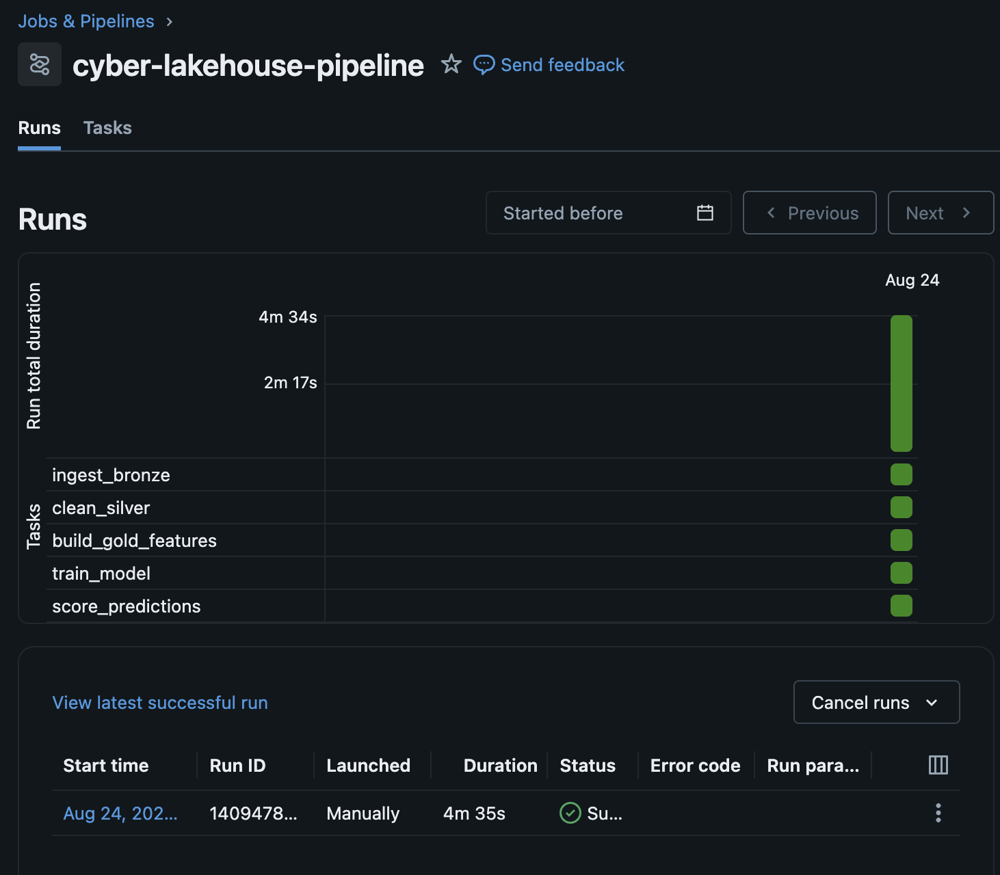

# Cyber Lakehouse – Network Intrusion Detection Pipeline

A lakehouse-style data engineering + ML pipeline for detecting malicious network traffic using Apache Spark, Delta Lake, and Python.
Processes the **full UNSW-NB15 dataset (2,540,047 network flow records)** through a Bronze → Silver → Gold architecture, trains and benchmarks three classifiers, and scores every flow at scale. Runs locally in Docker and deploys to Databricks (serverless + Unity Catalog).

---

## Project Overview

This project implements a Bronze → Silver → Gold lakehouse architecture to ingest, clean, feature-engineer, and analyze network flow data, followed by:

- Training and benchmarking three ML models (RandomForest, LogisticRegression, HistGradientBoosting)
- Scoring 2M+ flows via `mapInPandas` batch inference
- Querying results and data-quality checks using Spark SQL

The system is fully containerized (Docker) and also runs on Databricks — see [`databricks/README.md`](databricks/README.md).

---

## Architecture
```
Raw CSVs (full UNSW-NB15, 4 files, 2,540,047 rows, headerless 49-col schema)
   ↓
Bronze (raw Delta, explicit StructType, ingest metadata)
   ↓
Silver (cleaned Delta: label/category normalization, CSV-quirk fixes,
        SHA-256 flow-identity dedupe → 2,013,620 unique flows)
   ↓
Gold (54-feature ML table + analytics aggregates)
   ↓
ML Training (3-model benchmark, stratified 500k sample)
   ↓
Predictions (Delta, all 2M+ flows scored)
   ↓
SQL Analytics + Data Quality Checks
```
---

## Tech Stack
Category	| Tools
|----|----|
Data Processing	| Apache Spark (PySpark 3.5)
Storage	| Delta Lake 3.3
Cloud	| Databricks (serverless compute, Unity Catalog) — see [`databricks/`](databricks/)
ML	| scikit-learn
Orchestration	| Docker + Docker Compose
Language	| Python 3.11
Quality	| pytest, ruff, GitHub Actions CI
Dataset	| UNSW-NB15 (full dataset, 2.54M network flows)

---

## Dataset

The [UNSW-NB15 dataset](https://research.unsw.edu.au/projects/unsw-nb15-dataset) contains real benign traffic blended with 9 synthetic attack families (exploits, fuzzers, DoS, reconnaissance, generic, analysis, backdoor, shellcode, worms).

Fetch it (≈600MB, gitignored) with:
```
bash scripts/fetch_data.sh
```
The script pulls the 4 full-dataset CSVs from the Kaggle mirror into `data/raw/`. The CSVs are headerless with a 49-column schema (defined explicitly in `src/utils/schema.py` — no schema inference).

---

## Feature Engineering (54 features)

`src/utils/features.py` builds the gold feature table — shared verbatim by the local job and the Databricks notebook:

- **38 raw flow features** — durations, byte/packet counters, TTLs, TCP window/seq stats, jitter, inter-packet times, handshake timings, and the `ct_*` connection-context counters
- **13 derived features** — bytes-per-packet (src/dst), src:dst byte and packet ratios, load asymmetry, TTL delta, loss rates, packets-per-second, `log1p` transforms of heavy-tailed columns, duration buckets
- **3 frequency encodings** — `proto`, `service`, and `state` encoded as their dataset-level frequency

---

## Repository Structure
```
cyber-lakehouse/
│
├── src/
│   ├── jobs/                  # Spark jobs (Bronze → Gold, ML)
│   │   ├── 01_ingest_bronze.py
│   │   ├── 02_clean_silver.py
│   │   ├── 03_build_gold_features.py
│   │   ├── 04_train_model.py
│   │   └── 05_score_predictions.py
│   ├── utils/                 # Shared helpers (schema, features, io)
│   └── sql/                   # Spark SQL analytics + quality checks
│
├── databricks/                # Databricks notebooks + setup guide
├── scripts/                   # fetch_data.sh, run_job.sh
├── data/                      # bronze/silver/gold Delta tables (gitignored)
├── models/                    # Trained model artifacts (gitignored)
├── reports/                   # metrics.json (committed)
├── tests/                     # Unit tests (pure-python + local Spark)
├── docker/                    # spark.Dockerfile, docker-compose.yml
└── README.md
```

---

## Running the Pipeline

Requires Docker Desktop with ≥4GB memory for the VM.

1️⃣ Start the Spark container
```
docker compose -f docker/docker-compose.yml up -d --build
```
2️⃣ Run the lakehouse jobs (`scripts/run_job.sh` wraps `spark-submit` with the Delta Lake config)
```
./scripts/run_job.sh src/jobs/01_ingest_bronze.py        # 2,540,047 rows → Bronze
./scripts/run_job.sh src/jobs/02_clean_silver.py         # dedupe → 2,013,620 rows
./scripts/run_job.sh src/jobs/03_build_gold_features.py  # 54-feature table + analytics
```
(Windows: `.\run_spark_job.ps1 <job>` is the PowerShell equivalent.)

3️⃣ Train and benchmark the models
```
./scripts/run_job.sh src/jobs/04_train_model.py
```
Trains RandomForest, LogisticRegression, and HistGradientBoosting on a stratified 500k sample (`--max_rows` to change), writes the comparison to `reports/metrics.json`, and saves the best model by F1.

4️⃣ Score all flows
```
./scripts/run_job.sh src/jobs/05_score_predictions.py
```
Batch inference over the full gold table with `mapInPandas` (the model is loaded once per worker, so 2M+ rows never sit in one pandas frame).

---

## Model Results

Binary classification (attack vs. benign) on a stratified 500,000-row sample of the 2,013,620-flow gold table, 80/20 split, seed 42. The deduplicated data is heavily imbalanced (~4% attacks), so F1 and ROC-AUC matter more than accuracy.

| Model | Accuracy | Precision | Recall | F1 | ROC-AUC |
|---|---|---|---|---|---|
| **random_forest** (saved) | 0.9875 | 0.7679 | 0.9909 | 0.8652 | 0.9986 |
| logistic_regression | 0.9853 | 0.7351 | 0.9990 | 0.8470 | 0.9968 |
| hist_gradient_boosting | 0.9867 | 0.7542 | 0.9973 | 0.8589 | 0.9988 |

Full details in [`reports/metrics.json`](reports/metrics.json).

---

## Analytics & Data Quality (Spark SQL)

```
docker compose -f docker/docker-compose.yml exec spark \
  /usr/local/lib/python3.11/site-packages/pyspark/bin/spark-sql \
  --packages io.delta:delta-spark_2.12:3.3.1 \
  --conf spark.sql.extensions=io.delta.sql.DeltaSparkSessionExtension \
  --conf spark.sql.catalog.spark_catalog=org.apache.spark.sql.delta.catalog.DeltaCatalog \
  --conf spark.jars.ivy=/root/.ivy2 \
  -f src/sql/analytics.sql
```
- `src/sql/analytics.sql` — attack counts by category, prediction distribution, most suspicious flows
- `src/sql/quality_checks.sql` — per-layer row counts plus violation queries (null labels, negative durations, duplicate flow hashes, probability bounds, attack-rate sanity band) that must all return 0

---

## Databricks Deployment

The same pipeline runs on Databricks: serverless compute, Unity Catalog managed Delta tables (`cyber_lakehouse.bronze/silver/gold`), raw CSVs in a UC Volume, and notebooks that import the shared `src/utils` modules from the repo's Git folder — so local and cloud deployments can't drift. Setup guide and verification checklist: [`databricks/README.md`](databricks/README.md).

**Orchestration** — the five notebooks run as a 5-task Databricks Workflow with sequential dependencies (full run over the 2.54M-row dataset completes in under 5 minutes on serverless):



**Experiment tracking & model registry** — training logs each model as an MLflow run (params + accuracy/precision/recall/F1/ROC-AUC), and the best model is registered in Unity Catalog as `cyber_lakehouse.gold.attack_classifier`:


**Unity Catalog** — all layers live as governed tables/volumes under one catalog:


---

## Testing & Quality

```
uv run ruff check .
uv run ruff format --check .
uv run pytest          # feature-derivation tests run under a local SparkSession
```
`pyspark` is a dev-group dependency for the unit tests only (needs a local Java 17); the pipeline itself runs in Docker. CI (GitHub Actions) runs ruff + pytest with Java 17 on every push.

---

## Security & Engineering Practices

- Immutable data layers (Bronze/Silver/Gold) with explicit schema enforcement
- SHA-256 flow-identity deduplication
- SQL data-quality gates per layer
- Deterministic ML pipeline (fixed seeds, stratified sampling, committed metrics)
- Reproducible containerized environment; identical transformation code local + Databricks

---

## Why This Project?

This project demonstrates:

- Practical data engineering workflows at multi-million-row scale
- Spark + Delta Lake + Databricks integration
- ML embedded in a data pipeline with honest evaluation on imbalanced data
- Cybersecurity-focused analytics

Designed as a portfolio-grade project for roles in Data Engineering, Security Engineering, ML Engineering, and SOC automation.
