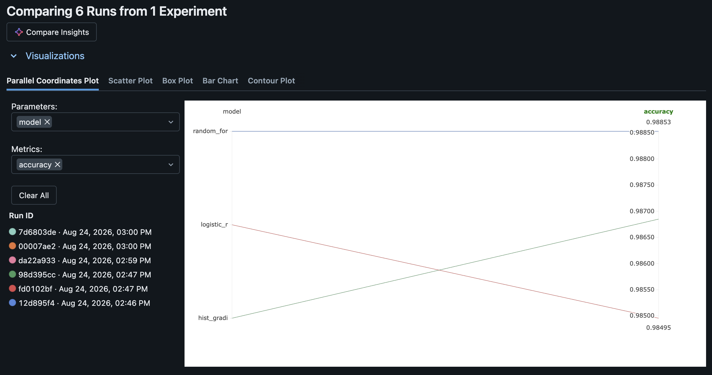

# Cyber Lakehouse – Network Intrusion Detection Pipeline

A lakehouse-style data engineering + ML pipeline for detecting malicious network traffic using Apache Spark, Delta Lake, and Python.
Processes the **full UNSW-NB15 dataset (2,540,047 network flow records)** through a Bronze → Silver → Gold architecture, trains and benchmarks three classifiers, and scores every flow at scale. Ingestion is **incremental and idempotent**: Structured Streaming / Auto Loader picks up new files only, and every downstream layer is an insert-only Delta MERGE fed by Change Data Feed, so reruns and re-delivered files never create duplicates. Runs locally in Docker and deploys to Databricks (serverless + Unity Catalog).

---

## Project Overview

This project implements a Bronze → Silver → Gold lakehouse architecture to ingest, clean, feature-engineer, and analyze network flow data, followed by:

- Incremental ingestion: a replay script delivers the raw data as chunk files over time, and each run processes only what's new
- Training and benchmarking three ML models (RandomForest, LogisticRegression, HistGradientBoosting)
- Incrementally scoring 2M+ flows via `mapInPandas` inference
- Querying results and data-quality checks using Spark SQL

The system is fully containerized (Docker) and also runs on Databricks — see [`databricks/README.md`](databricks/README.md).

**Documentation:** [architecture](docs/architecture.md) · [data model](docs/data-model.md) · [operations runbook](docs/operations.md) · [design decisions (ADRs)](docs/adr/README.md)

---

## Architecture
```
Raw CSVs (full UNSW-NB15, 4 files, 2,540,047 rows, headerless 49-col schema)
   ↓  replay: 250k-row chunk files released over time (atomic rename)
Landing (data/landing/incoming/)
   ↓  Structured Streaming file source / Auto Loader, checkpointed, availableNow
Bronze (raw append-only Delta, explicit StructType, ingest metadata)
   ↓  stream → per-batch dedupe → insert-only MERGE on flow_hash
Silver (cleaned Delta: label/category normalization, CSV-quirk fixes,
        SHA-256 flow-identity dedupe → 2,013,620 unique flows; CDF on)
   ↓  Change Data Feed inserts → insert-only MERGE
Gold (row-wise ML feature table + analytics aggregates; CDF on)
   ↓
ML Training (3-model benchmark, stratified 500k sample;
             freezes the frequency-encoding map → gold/freq_encodings)
   ↓  Change Data Feed inserts → frozen encodings → mapInPandas → insert-only MERGE
Predictions (Delta, every flow scored exactly once per model)
   ↓
SQL Analytics + Data Quality Checks
```
---

## Tech Stack
Category	| Tools
|----|----|
Data Processing	| Apache Spark (PySpark 3.5)
Storage	| Delta Lake 3.3
Cloud	| Databricks (serverless compute, Unity Catalog) — see [`databricks/`](databricks/)
ML	| scikit-learn
Orchestration	| Docker + Docker Compose
Language	| Python 3.11
Quality	| pytest, ruff, GitHub Actions CI
Dataset	| UNSW-NB15 (full dataset, 2.54M network flows)

---

## Dataset

The [UNSW-NB15 dataset](https://research.unsw.edu.au/projects/unsw-nb15-dataset) contains real benign traffic blended with 9 synthetic attack families (exploits, fuzzers, DoS, reconnaissance, generic, analysis, backdoor, shellcode, worms).

Fetch it (≈600MB, gitignored) with:
```
bash scripts/fetch_data.sh
```
The script pulls the 4 full-dataset CSVs from the Kaggle mirror into `data/raw/`. The CSVs are headerless with a 49-column schema (defined explicitly in `src/utils/schema.py` — no schema inference).

---

## Feature Engineering (54 features)

`src/utils/features.py` builds the gold feature table — shared verbatim by the local job and the Databricks notebook:

- **38 raw flow features** — durations, byte/packet counters, TTLs, TCP window/seq stats, jitter, inter-packet times, handshake timings, and the `ct_*` connection-context counters
- **13 derived features** — bytes-per-packet (src/dst), src:dst byte and packet ratios, load asymmetry, TTL delta, loss rates, packets-per-second, `log1p` transforms of heavy-tailed columns, duration buckets
- **3 frequency encodings** — `proto`, `service`, and `state` encoded as their dataset-level frequency. The map is computed once at training time and persisted (`gold/freq_encodings`); scoring applies the same table, so an incremental micro-batch can't skew it (unseen values encode as 0)

---

## Repository Structure
```
cyber-lakehouse/
│
├── src/
│   ├── jobs/                  # Spark jobs (Bronze → Gold, ML)
│   │   ├── 01_ingest_bronze.py
│   │   ├── 02_clean_silver.py
│   │   ├── 03_build_gold_features.py
│   │   ├── 04_train_model.py
│   │   └── 05_score_predictions.py
│   ├── utils/                 # Shared helpers (schema, features, io)
│   └── sql/                   # Spark SQL analytics + quality checks
│
├── databricks/                # Databricks notebooks + setup guide
├── scripts/                   # fetch_data.sh, run_job.sh
├── data/                      # bronze/silver/gold Delta tables (gitignored)
├── models/                    # Trained model artifacts (gitignored)
├── reports/                   # metrics.json (committed)
├── tests/                     # Unit tests (pure-python + local Spark)
├── docker/                    # spark.Dockerfile, docker-compose.yml
└── README.md
```

---

## Running the Pipeline

Requires Docker Desktop with ≥4GB memory for the VM.

1️⃣ Start the Spark container
```
docker compose -f docker/docker-compose.yml up -d --build
```
2️⃣ Deliver data into the landing zone
```
uv run python -m src.utils.replay --files 3   # next 3 chunks (250k rows each); --files 0 = everything
```
The replay script splits the raw CSVs into chunk files and moves the next N into `data/landing/incoming/`, simulating logs arriving over time.

3️⃣ Run the incremental pipeline (`scripts/run_job.sh` wraps `spark-submit` with the Delta Lake config)
```
./scripts/run_job.sh src/jobs/01_ingest_bronze.py        # new landing files → Bronze (append)
./scripts/run_job.sh src/jobs/02_clean_silver.py         # new Bronze rows → Silver (dedupe + MERGE)
./scripts/run_job.sh src/jobs/03_build_gold_features.py  # new Silver rows → Gold features + analytics
./scripts/run_job.sh src/jobs/05_score_predictions.py    # new Gold rows → predictions (skips if no model yet)
```
Each job is a checkpointed stream with an `availableNow` trigger: it processes everything new since its last run, then stops. Repeat steps 2–3 as often as you like; with everything released, Silver holds 2,013,620 unique flows. (Windows: `.\run_spark_job.ps1 <job>` is the PowerShell equivalent.)

4️⃣ Train and benchmark the models, then rescore everything
```
./scripts/run_job.sh src/jobs/04_train_model.py
./scripts/run_job.sh src/jobs/05_score_predictions.py --full_refresh
```
Training freezes the frequency-encoding map, trains RandomForest, LogisticRegression, and HistGradientBoosting on a stratified 500k sample (`--max_rows` to change), writes the comparison to `reports/metrics.json`, and saves the best model by F1. `--full_refresh` drops the predictions table and its checkpoint so every flow is rescored with the new model (the model is loaded once per worker, so 2M+ rows never sit in one pandas frame).

To start over from scratch: `rm -rf data/{landing,bronze,silver,gold,checkpoints}`.

### Idempotency check

```
./scripts/verify_incremental.sh --reset   # wipes local pipeline data first
```
Runs the pipeline in Docker on small chunks and fails on any mismatch: a rerun with no new files changes nothing, a chunk re-delivered under a new name lands in Bronze but adds nothing to Silver/Gold, new chunks flow all the way through, and after training every Gold flow is scored exactly once (a second scoring run adds nothing).

---

## Model Results

Binary classification (attack vs. benign) on a stratified 500,000-row sample of the 2,013,620-flow gold table, 80/20 split, seed 42. The deduplicated data is heavily imbalanced (~4% attacks), so F1 and ROC-AUC matter more than accuracy.

| Model | Accuracy | Precision | Recall | F1 | ROC-AUC |
|---|---|---|---|---|---|
| **random_forest** (saved) | 0.9873 | 0.7660 | 0.9922 | 0.8646 | 0.9985 |
| logistic_regression | 0.9846 | 0.7268 | 0.9990 | 0.8414 | 0.9967 |
| hist_gradient_boosting | 0.9867 | 0.7560 | 0.9978 | 0.8602 | 0.9989 |

Full details in [`reports/metrics.json`](reports/metrics.json).

---

## Analytics & Data Quality (Spark SQL)

```
docker compose -f docker/docker-compose.yml exec spark \
  /usr/local/lib/python3.11/site-packages/pyspark/bin/spark-sql \
  --packages io.delta:delta-spark_2.12:3.3.1 \
  --conf spark.sql.extensions=io.delta.sql.DeltaSparkSessionExtension \
  --conf spark.sql.catalog.spark_catalog=org.apache.spark.sql.delta.catalog.DeltaCatalog \
  --conf spark.jars.ivy=/root/.ivy2 \
  -f src/sql/analytics.sql
```
- `src/sql/analytics.sql` — attack counts by category, prediction distribution, most suspicious flows
- `src/sql/quality_checks.sql` — per-layer row counts plus violation queries (null labels, negative durations, duplicate flow hashes in Silver and Gold, probability bounds, unscored or double-scored flows, attack-rate sanity band) that must all return 0

---

## Databricks Deployment

The same pipeline runs on Databricks: serverless compute, Auto Loader over a landing Volume, Unity Catalog managed Delta tables (`cyber_lakehouse.bronze/silver/gold`) with Change Data Feed, stream checkpoints in a UC Volume, and notebooks that import the shared `src/utils` modules from the repo's Git folder — so local and cloud deployments can't drift. It is split into two Workflows: `cyber-lakehouse-pipeline` (replay → bronze → silver → gold → incremental scoring, run repeatedly) and `cyber-lakehouse-train` (train → full rescore, on demand). Setup guide and verification checklist: [`databricks/README.md`](databricks/README.md).

**Incremental pipeline Workflow** — each run of `cyber-lakehouse-pipeline` delivers the next 3 chunks (~750k rows) and processes only those through every layer, in 2–3 minutes on serverless. The last run below had nothing new to deliver and left every table's row count unchanged:


**Training Workflow** — `cyber-lakehouse-train` retrains, freezes the encodings, and rescores every flow (`full_refresh`) in ~4.5 minutes:


**Incremental writes** — silver's Delta history shows one insert-only `MERGE` per pipeline run instead of a full overwrite:


Verified on Databricks (2026-10-12): bronze 2,540,047; silver = gold = predictions = 2,013,620; 0 duplicate `flow_hash` values — identical to the local run.

**Experiment tracking & model registry** — training logs each model as an MLflow run (params + accuracy/precision/recall/F1/ROC-AUC), and the best model is registered in Unity Catalog as `cyber_lakehouse.gold.attack_classifier`:



**Unity Catalog** — all layers live as governed tables/volumes under one catalog:


---

## Testing & Quality

```
uv run ruff check .
uv run ruff format --check .
uv run pytest          # feature-derivation tests run under a local SparkSession
```
`pyspark` is a dev-group dependency for the unit tests only (needs a local Java 17); the pipeline itself runs in Docker. CI (GitHub Actions) runs ruff + pytest with Java 17 on every push.

---

## Security & Engineering Practices

- Immutable data layers (Bronze/Silver/Gold) with explicit schema enforcement
- Incremental, idempotent ingestion: checkpointed streams + insert-only Delta MERGE + Change Data Feed
- SHA-256 flow-identity deduplication
- No train/serve skew: categorical encodings frozen at training time and reused at scoring
- SQL data-quality gates per layer
- Deterministic ML pipeline (fixed seeds, stratified sampling, committed metrics)
- Reproducible containerized environment; identical transformation code local + Databricks

---

## Why This Project?

This project demonstrates:

- Practical data engineering workflows at multi-million-row scale
- Spark + Delta Lake + Databricks integration
- ML embedded in a data pipeline with honest evaluation on imbalanced data
- Cybersecurity-focused analytics

Designed as a portfolio-grade project for roles in Data Engineering, Security Engineering, ML Engineering, and SOC automation.
