# Cyber Lakehouse – Network Intrusion Detection Pipeline

A lakehouse-style data engineering + ML pipeline for detecting malicious network traffic using Apache Spark, Delta Lake, and Python.
Processes the **full UNSW-NB15 dataset (2,540,047 network flow records)** through a Bronze → Silver → Gold architecture, trains and benchmarks attack-detection and attack-family classifiers with an honest train/validation/test protocol, and scores every flow at scale. Ingestion is **incremental and idempotent**: Structured Streaming / Auto Loader picks up new files only, and every downstream layer is an insert-only Delta MERGE fed by Change Data Feed, so reruns and re-delivered files never create duplicates. Runs locally in Docker and deploys to Databricks (serverless + Unity Catalog).

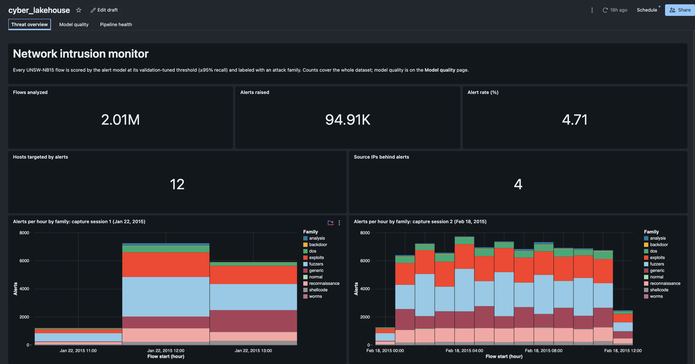

*The project's Databricks dashboard, built from the pipeline's own tables; [more below](#databricks-deployment).*

---

## Project Overview

This project implements a Bronze → Silver → Gold lakehouse architecture to ingest, clean, feature-engineer, and analyze network flow data, followed by:

- Incremental ingestion: a replay script delivers the raw data as chunk files over time, and each run processes only what's new
- Training and benchmarking three model families (RandomForest, LogisticRegression, HistGradientBoosting) for two tasks: attack vs. benign, with the alert threshold tuned on a validation set for a SOC operating point (≥95% recall), and which of 9 attack families a flow belongs to
- Incrementally scoring 2M+ flows via `mapInPandas` inference
- A data-quality gate after every run (results kept in `gold.quality_results`) and a three-page Databricks AI/BI dashboard: threat overview, model quality, pipeline health

The system is fully containerized (Docker) and also runs on Databricks — see [`databricks/README.md`](databricks/README.md).

**Documentation:** [architecture](docs/architecture.md) · [data model](docs/data-model.md) · [operations runbook](docs/operations.md) · [design decisions (ADRs)](docs/adr/README.md)

---

## Architecture
```
Raw CSVs (full UNSW-NB15, 4 files, 2,540,047 rows, headerless 49-col schema)
   ↓  replay: 250k-row chunk files released over time (atomic rename)
Landing (data/landing/incoming/)
   ↓  Structured Streaming file source / Auto Loader, checkpointed, availableNow
Bronze (raw append-only Delta, explicit StructType, ingest metadata)
   ↓  stream → per-batch dedupe → insert-only MERGE on flow_hash
Silver (cleaned Delta: label/category normalization, CSV-quirk fixes,
        SHA-256 flow-identity dedupe → 2,013,620 unique flows; CDF on)
   ↓  Change Data Feed inserts → insert-only MERGE
Gold (row-wise ML feature table + analytics aggregates; CDF on)
   ↓
ML Training (stratified 500k sample, 60/20/20 train/val/test;
             binary model + validation-tuned alert threshold,
             10-class attack-family model;
             freezes the frequency-encoding map → gold/freq_encodings)
   ↓  Change Data Feed inserts → frozen encodings → mapInPandas → insert-only MERGE
Predictions (Delta, every flow scored exactly once per model)
   ↓  11 data-quality checks per run → gold.quality_results (failure fails the run)
Dashboard (Databricks AI/BI: alerts, model quality, pipeline health)
```
---

## Tech Stack
Category	| Tools
|----|----|
Data Processing	| Apache Spark (PySpark 3.5)
Storage	| Delta Lake 3.3
Cloud	| Databricks (serverless compute, Unity Catalog) — see [`databricks/`](databricks/)
ML	| scikit-learn
Orchestration	| Docker + Docker Compose
Language	| Python 3.11
Quality	| pytest, ruff, GitHub Actions CI
Dataset	| UNSW-NB15 (full dataset, 2.54M network flows)

---

## Dataset

The [UNSW-NB15 dataset](https://research.unsw.edu.au/projects/unsw-nb15-dataset) contains real benign traffic blended with 9 synthetic attack families (exploits, fuzzers, DoS, reconnaissance, generic, analysis, backdoor, shellcode, worms).

Fetch it (≈600MB, gitignored) with:
```
bash scripts/fetch_data.sh
```
The script pulls the 4 full-dataset CSVs from the Kaggle mirror into `data/raw/`. The CSVs are headerless with a 49-column schema (defined explicitly in `src/utils/schema.py` — no schema inference).

---

## Feature Engineering (54 features)

`src/utils/features.py` builds the gold feature table — shared verbatim by the local job and the Databricks notebook:

- **38 raw flow features** — durations, byte/packet counters, TTLs, TCP window/seq stats, jitter, inter-packet times, handshake timings, and the `ct_*` connection-context counters
- **13 derived features** — bytes-per-packet (src/dst), src:dst byte and packet ratios, load asymmetry, TTL delta, loss rates, packets-per-second, `log1p` transforms of heavy-tailed columns, duration buckets
- **3 frequency encodings** — `proto`, `service`, and `state` encoded as their dataset-level frequency. The map is computed once at training time and persisted (`gold/freq_encodings`); scoring applies the same table, so an incremental micro-batch can't skew it (unseen values encode as 0)

---

## Repository Structure
```
cyber-lakehouse/
│
├── src/
│   ├── jobs/                  # Spark jobs (Bronze → Gold, ML)
│   │   ├── 01_ingest_bronze.py
│   │   ├── 02_clean_silver.py
│   │   ├── 03_build_gold_features.py
│   │   ├── 04_train_model.py
│   │   ├── 05_score_predictions.py
│   │   └── 06_quality_checks.py
│   ├── utils/                 # Shared helpers (schema, cleaning, features, incremental, modeling, quality, io)
│   └── sql/                   # Ad-hoc Spark SQL analytics
│
├── databricks/                # Databricks notebooks, AI/BI dashboard (dashboards/), setup guide
├── scripts/                   # fetch_data.sh, fetch_cic.sh, run_job.sh
├── data/                      # bronze/silver/gold Delta tables (gitignored)
├── models/                    # Trained model artifacts (gitignored)
├── reports/                   # metrics.json, cross_dataset.json (committed)
├── tests/                     # Unit tests (pure-python + local Spark)
├── docker/                    # spark.Dockerfile, docker-compose.yml
└── README.md
```

---

## Running the Pipeline

Requires Docker Desktop with ≥4GB memory for the VM.

1️⃣ Start the Spark container
```
docker compose -f docker/docker-compose.yml up -d --build
```
2️⃣ Deliver data into the landing zone
```
uv run python -m src.utils.replay --files 3   # next 3 chunks (250k rows each); --files 0 = everything
```
The replay script splits the raw CSVs into chunk files and moves the next N into `data/landing/incoming/`, simulating logs arriving over time.

3️⃣ Run the incremental pipeline (`scripts/run_job.sh` wraps `spark-submit` with the Delta Lake config)
```
./scripts/run_job.sh src/jobs/01_ingest_bronze.py        # new landing files → Bronze (append)
./scripts/run_job.sh src/jobs/02_clean_silver.py         # new Bronze rows → Silver (dedupe + MERGE)
./scripts/run_job.sh src/jobs/03_build_gold_features.py  # new Silver rows → Gold features + analytics
./scripts/run_job.sh src/jobs/05_score_predictions.py    # new Gold rows → predictions (skips until training has run)
./scripts/run_job.sh src/jobs/06_quality_checks.py       # 11 checks → gold/quality_results; exits non-zero on a failure
```
Each job is a checkpointed stream with an `availableNow` trigger: it processes everything new since its last run, then stops. Repeat steps 2–3 as often as you like; with everything released, Silver holds 2,013,620 unique flows. (Windows: `.\run_spark_job.ps1 <job>` is the PowerShell equivalent.)

4️⃣ Train and benchmark the models, then rescore everything
```
./scripts/run_job.sh src/jobs/04_train_model.py
./scripts/run_job.sh src/jobs/05_score_predictions.py --full_refresh
```
Training freezes the frequency-encoding map, splits a stratified 500k sample (`--max_rows` to change) 60/20/20, benchmarks the binary and attack-family models, and writes `models/trained_model.pkl`, `models/attack_family_model.pkl`, `models/model_meta.json` (alert threshold, feature order), and `reports/metrics.json`. `--full_refresh` drops the predictions table and its checkpoint so every flow is rescored with the new models (they are loaded once per worker, so 2M+ rows never sit in one pandas frame).

To start over from scratch: `rm -rf data/{landing,bronze,silver,gold,checkpoints}`.

### Idempotency check

```
./scripts/verify_incremental.sh --reset   # wipes local pipeline data first
```
Runs the pipeline in Docker on small chunks and fails on any mismatch: a rerun with no new files changes nothing, a chunk re-delivered under a new name lands in Bronze but adds nothing to Silver/Gold, new chunks flow all the way through, and after training every Gold flow is scored exactly once (a second scoring run adds nothing).

---

## Model Results

**Protocol.** Stratified 500,000-row sample of the 2,013,620-flow gold table (~4% attacks), split **60/20/20 train/validation/test** stratified by attack family, seed 42. Every choice (alert threshold, which model to keep) is made on validation; the test split is only used to report the numbers below.

### Attack detection (binary)

Each model's alert threshold is the **highest-precision threshold that still catches ≥95% of validation attacks**, a SOC-style operating point. The kept model has the highest validation precision at that floor.

| Model | Threshold | Precision | Recall | F1 | ROC-AUC | F1 at 0.5 |
|---|---|---|---|---|---|---|
| **hist_gradient_boosting** (saved) | 0.912 | **0.8394** | 0.9453 | **0.8892** | 0.9988 | 0.8546 |
| random_forest | 0.766 | 0.8167 | 0.9546 | 0.8803 | 0.9985 | 0.8613 |
| logistic_regression | 0.948 | 0.7692 | 0.9500 | 0.8501 | 0.9964 | 0.8407 |

**The trade-off:** the previous model alerted at a fixed 0.5 with precision 0.766 and recall 0.992, so about 1 in 4 alerts was a false alarm. Tuning the threshold cuts false alarms to about 1 in 6 alerts (precision **0.84**) while still catching **94.5%** of attacks, raising F1 from 0.865 to 0.889. Scoring applies the saved threshold automatically.

### Attack family (10 classes)

A separate model labels each flow as `normal` or one of the 9 attack families, selected by validation macro-F1. It names the attack type for alerts; the binary model above remains the detector.

| Model | Val macro-F1 | Test macro-F1 | Test accuracy |
|---|---|---|---|
| **random_forest** (saved) | 0.680 | **0.585** | 0.980 |
| hist_gradient_boosting | 0.633 | 0.574 | 0.979 |
| logistic_regression | 0.439 | 0.434 | 0.969 |

Per family (test, saved model). Accuracy is dominated by `normal`, so the per-family numbers are the honest view:

| Family | Precision | Recall | F1 | Test flows |
|---|---|---|---|---|
| normal | 1.000 | 0.985 | 0.992 | 95,971 |
| generic | 0.973 | 0.912 | 0.942 | 867 |
| reconnaissance | 0.862 | 0.898 | 0.879 | 589 |
| exploits | 0.775 | 0.875 | 0.822 | 1,267 |
| shellcode | 0.578 | 0.747 | 0.652 | 79 |
| fuzzers | 0.426 | 0.961 | 0.590 | 1,017 |
| backdoor | 0.467 | 0.350 | 0.400 | 20 |
| dos | 0.461 | 0.301 | 0.364 | 216 |
| analysis | 0.131 | 0.556 | 0.212 | 36 |
| worms | 0.000 | 0.000 | 0.000 | 7 |

Where it struggles: 1,245 benign flows are labeled `fuzzers` (hence fuzzers' low precision), about half of `dos` flows are labeled `exploits` (a known overlap in UNSW-NB15), and the rarest families have too few examples to learn (7 `worms` flows in the test set).

Full details, including every model's validation metrics and the confusion matrix, in [`reports/metrics.json`](reports/metrics.json).

### Cross-dataset test: does it generalize? (CIC-IDS2017)

Scores on UNSW-NB15 say nothing about traffic from another network. To test that, a detector trained on UNSW is scored on [CIC-IDS2017](https://www.unb.ca/cic/datasets/ids-2017.html), which comes from a different lab, a different set of attacks, and a different flow tool (CICFlowMeter instead of Argus/Bro).

Only 7 measurements mean the same thing in both datasets: duration, bytes and packets in each direction, and the mean inter-packet time in each direction. CIC values are converted to UNSW units (µs → s and ms; CIC payload bytes + header bytes, because UNSW counts include headers). The detector is retrained on UNSW using only those 7 plus 12 features derived from them with the gold-layer formulas, 19 in total. TTLs, protocol/service/state, the `ct_*` counters, and TCP window sizes have no matching CIC field or use different units, so they are left out. The protocol is unchanged: 60/20/20 split, ≥95%-recall threshold. Each dataset is deduplicated and sampled down to 500k flows.

| Model | Tested on | Precision | Recall | F1 | ROC-AUC |
|---|---|---|---|---|---|
| UNSW, all 54 features (reference) | UNSW | 0.8394 | 0.9453 | 0.8892 | 0.9988 |
| UNSW, 19 portable features | UNSW | 0.7873 | 0.9491 | 0.8607 | 0.9979 |
| **UNSW portable → CIC** (UNSW threshold) | CIC | **0.0258** | **0.0315** | **0.0284** | **0.4700** |
| CIC-trained, same features (ceiling) | CIC | 0.9988 | 0.9563 | 0.9771 | 0.9997 |

**The detector does not transfer.** On CIC it catches 3% of attacks, flags 24% of benign flows, and ranks flows slightly worse than random (ROC-AUC 0.47). It is not a threshold problem either: no threshold catches 95% of CIC attacks above 19% precision, against a 16.5% attack rate in the CIC test split. The features themselves are not the cause. Dropping to 19 portable features costs only 0.03 F1 on UNSW, and a model trained on CIC with the same 19 features reaches 0.977 F1. What the UNSW model learned is specific to UNSW:

- **CIC benign traffic looks like UNSW attacks.** The median CIC benign flow is 2 packets and 140 bytes (mostly short DNS-style exchanges). The median UNSW benign flow is 16–18 packets and about 2 KB, while UNSW's `generic` attacks have a median of 2 packets and 114 bytes. Short and small reads as "attack" to the UNSW model.
- **CIC attacks look like nothing UNSW labels as an attack.** CIC's DoS flows are long, slow connections (median 60–100 s for Hulk, Slowloris, SlowHTTPTest), and most UNSW attacks finish in under a second.

Per CIC attack type, the UNSW detector catches 0–12% of every family with at least 30 test flows (DDoS 3.4%, DoS Hulk 3.0%). The CIC-trained model catches 98–99% of the two largest (DDoS, DoS Hulk). In practice, a detector like this has to be retrained or fine-tuned on traffic from the network it protects, so the 0.89 F1 above is a within-dataset number. This is consistent with published cross-dataset studies of these benchmarks.

Reproduce with `bash scripts/fetch_cic.sh` (~850 MB from a public Kaggle mirror, no account needed) and `./scripts/run_job.sh src/jobs/evaluate_cross_dataset.py`. Full results are in [`reports/cross_dataset.json`](reports/cross_dataset.json). Design reasoning: [ADR-0021](docs/adr/0021-cross-dataset-evaluation-on-portable-features.md).

---

## Data Quality

`src/utils/quality.py` defines 11 checks that must each find zero violations:
- **Silver:** null labels, negative durations, duplicate flow hashes
- **Gold:** duplicate flow hashes, `is_attack` outside {0, 1}, nulls in key features, attack share outside the 2–25% sanity band
- **Predictions:** probabilities outside [0, 1], missing attack-family labels, unscored flows, flows scored twice

`06_quality_checks` runs them at the end of every pipeline run and appends one row per check to `gold.quality_results`, so the history is kept. If any check fails, the job fails, which makes it a gate. A check on a table that doesn't exist yet, such as predictions before the first training run, is recorded as `missing`, not as a failure.

Ad-hoc analytics queries (attack counts by category, prediction distribution, most suspicious flows) are in `src/sql/analytics.sql`:
```
docker compose -f docker/docker-compose.yml exec spark \
  /usr/local/lib/python3.11/site-packages/pyspark/bin/spark-sql \
  --packages io.delta:delta-spark_2.12:3.3.1 \
  --conf spark.sql.extensions=io.delta.sql.DeltaSparkSessionExtension \
  --conf spark.sql.catalog.spark_catalog=org.apache.spark.sql.delta.catalog.DeltaCatalog \
  --conf spark.jars.ivy=/root/.ivy2 \
  -f src/sql/analytics.sql
```

---

## Databricks Deployment

The same pipeline runs on Databricks: serverless compute, Auto Loader over a landing Volume, Unity Catalog managed Delta tables (`cyber_lakehouse.bronze/silver/gold`) with Change Data Feed, stream checkpoints in a UC Volume, and notebooks that import the shared `src/utils` modules from the repo's Git folder — so local and cloud deployments can't drift. It is split into two Workflows: `cyber-lakehouse-pipeline` (replay → bronze → silver → gold → incremental scoring → quality gate, run repeatedly) and `cyber-lakehouse-train` (train → full rescore, on demand). Setup guide and verification checklist: [`databricks/README.md`](databricks/README.md).

**Dashboard** — [`databricks/dashboards/cyber_lakehouse.lvdash.json`](databricks/dashboards/cyber_lakehouse.lvdash.json) is a three-page Databricks AI/BI dashboard kept in version control:
- **Threat overview:** alerts per hour by attack family (one chart per capture session), alerts by family, most-targeted hosts, highest-confidence alerts
- **Model quality:** the selected threshold, precision and recall, plus every candidate model. All numbers are from the test split only.
- **Pipeline health:** latest data-quality results, recent quality runs, raw rows vs. new unique flows per micro-batch (and the share removed as duplicates), rows per layer

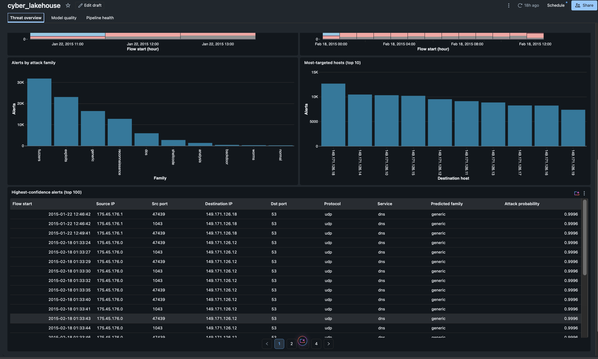

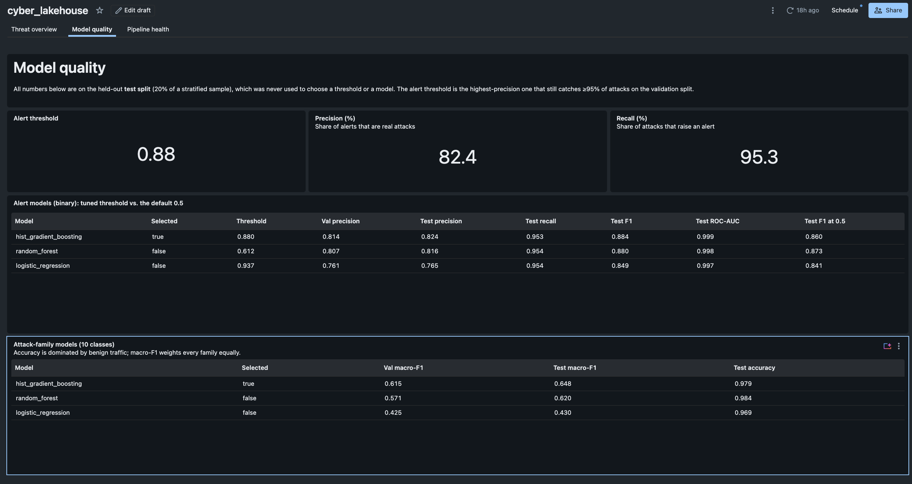

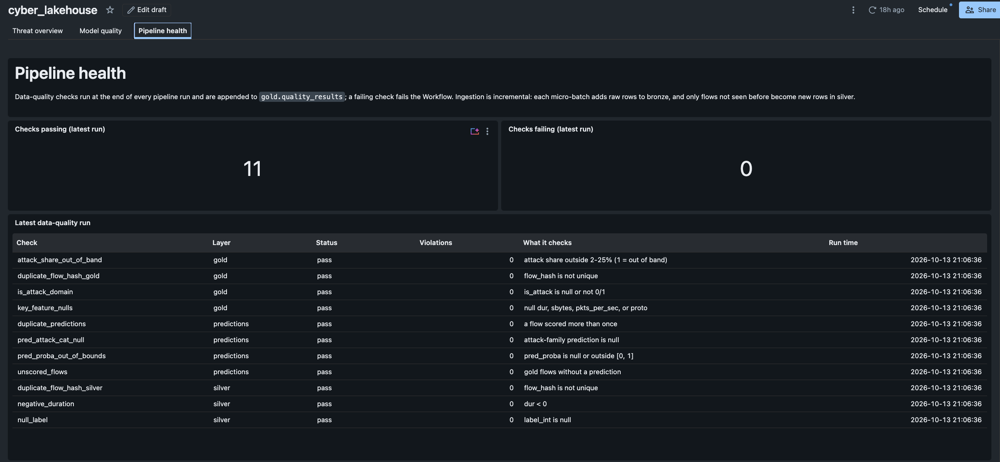

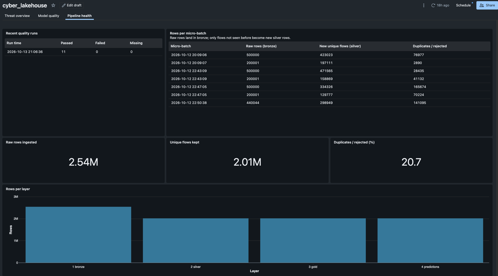

The micro-batch table reconciles exactly: its duplicates column sums to 526,427, which is 2,540,047 raw rows minus 2,013,620 unique flows.

**Incremental pipeline Workflow** — each run of `cyber-lakehouse-pipeline` delivers the next 3 chunks (~750k rows) and processes only those through every layer, in 2–3 minutes on serverless. The last run below had nothing new to deliver and left every table's row count unchanged:

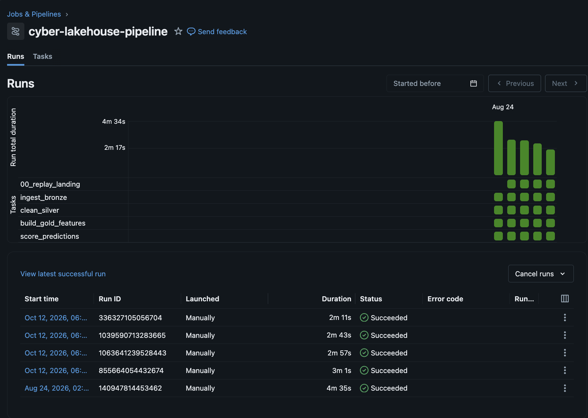

**Training Workflow** — `cyber-lakehouse-train` retrains, freezes the encodings, and rescores every flow (`full_refresh`) in ~4.5 minutes:

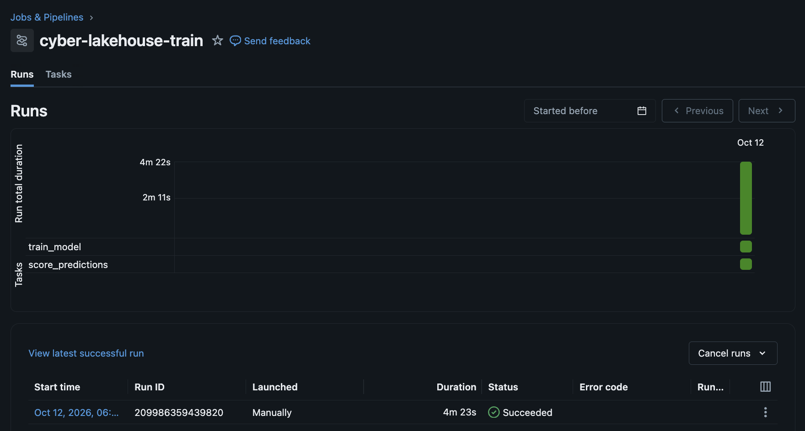

**Incremental writes** — silver's Delta history shows one insert-only `MERGE` per pipeline run instead of a full overwrite:

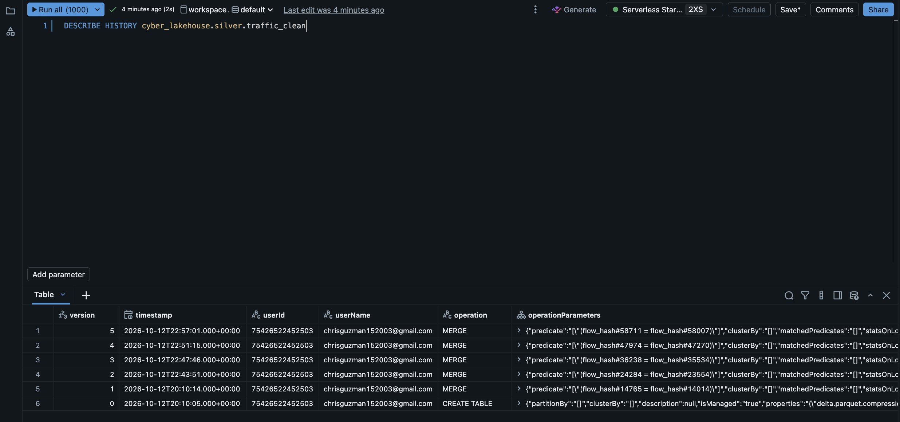

Verified on Databricks (2026-10-12): bronze 2,540,047; silver = gold = predictions = 2,013,620; 0 duplicate `flow_hash` values — identical to the local run.

**Experiment tracking & model registry** — training logs every candidate as an MLflow run: binary runs with their validation-tuned threshold, validation precision, and test metrics; family runs with validation and test macro-F1. The best of each is registered in Unity Catalog as `cyber_lakehouse.gold.attack_classifier` and `cyber_lakehouse.gold.attack_family_classifier`.

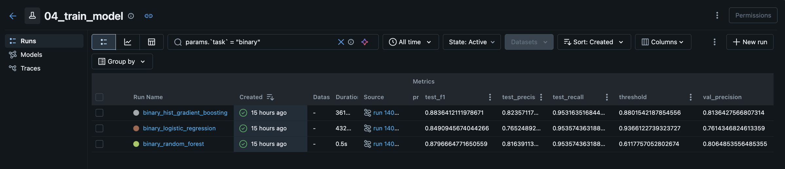

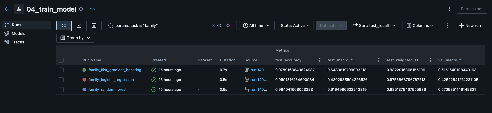

On Databricks (300k-row training sample) the selected alert model is again **HistGradientBoosting**: threshold 0.880, test precision **0.824**, recall **0.953**, F1 **0.884**, so the 95% recall floor held on the test set as well. For attack families, HistGradientBoosting edged out RandomForest on validation macro-F1 this time (0.615 vs 0.571; test macro-F1 0.648). The local run picked RandomForest. With so few examples of the rarest families, which model wins depends on the sample, so the two runs agree on the pattern rather than on a single winner.

**Scored predictions** — every flow gets an alert decision at the tuned threshold and an attack-family label. Of 2,013,620 flows, 94,913 raise an alert (4.7%, close to the ~4% true attack share); flows labeled `normal` almost never alert (194), while those labeled generic, exploits, reconnaissance, or worms almost always do:

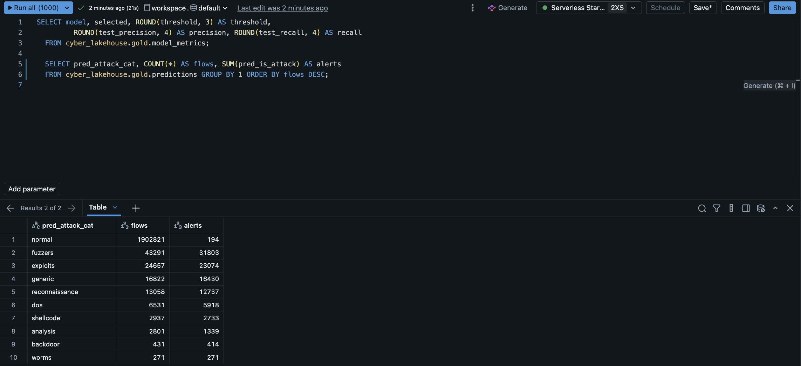

**Unity Catalog** — all layers live as governed tables/volumes under one catalog:

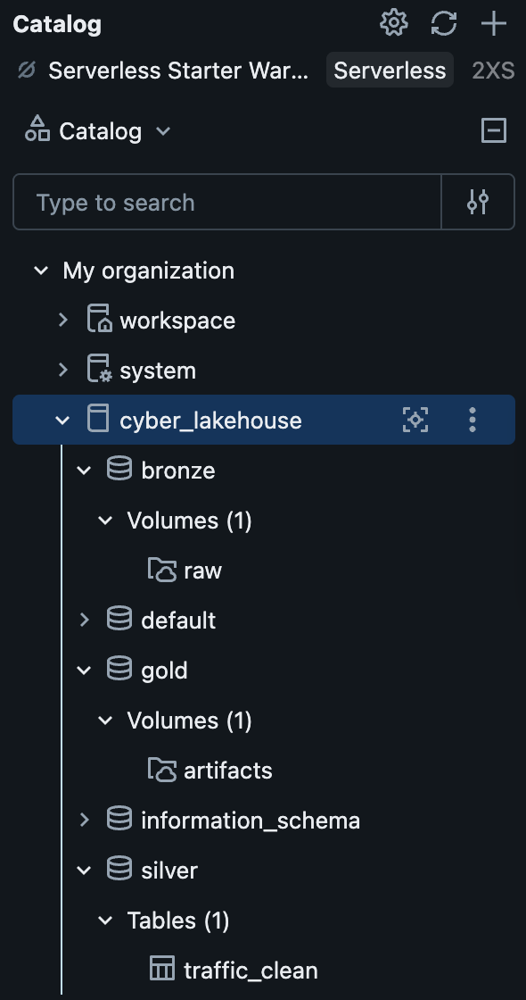

---

## Testing & Quality

```
uv run ruff check .
uv run ruff format --check .
uv run pytest          # feature-derivation tests run under a local SparkSession
```
`pyspark` is a dev-group dependency for the unit tests only (needs a local Java 17); the pipeline itself runs in Docker. CI (GitHub Actions) runs ruff + pytest with Java 17 on every push.

---

## Security & Engineering Practices

- Immutable data layers (Bronze/Silver/Gold) with explicit schema enforcement
- Incremental, idempotent ingestion: checkpointed streams + insert-only Delta MERGE + Change Data Feed
- SHA-256 flow-identity deduplication
- No train/serve skew: categorical encodings frozen at training time and reused at scoring
- Data-quality gate after every run, with each run's results kept for trend tracking
- Deterministic ML pipeline (fixed seeds, stratified sampling, committed metrics)
- Reproducible containerized environment; identical transformation code local + Databricks

---

## Why This Project?

This project demonstrates:

- Practical data engineering workflows at multi-million-row scale
- Spark + Delta Lake + Databricks integration
- ML embedded in a data pipeline with honest evaluation on imbalanced data
- Cybersecurity-focused analytics

Designed as a portfolio-grade project for roles in Data Engineering, Security Engineering, ML Engineering, and SOC automation.
