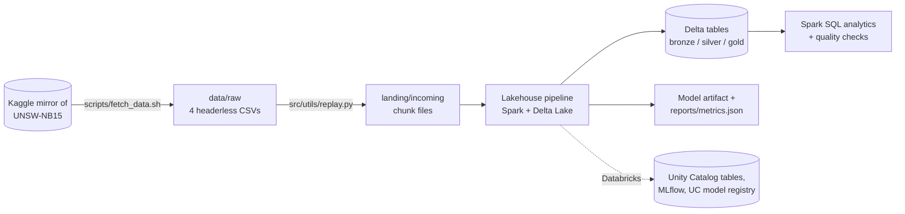
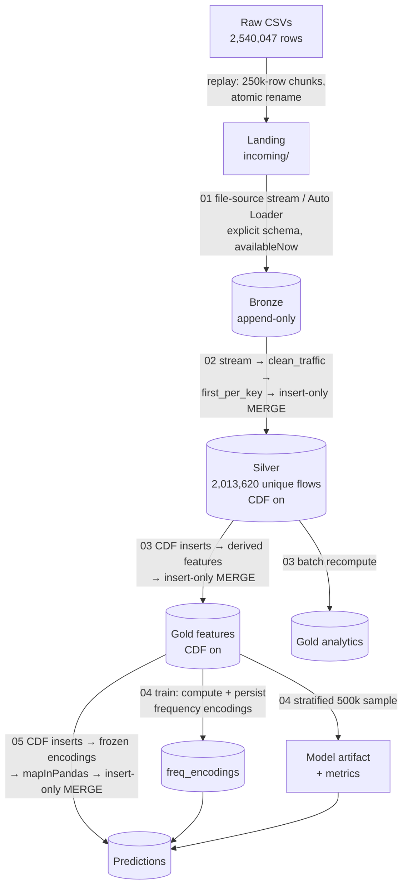

# Architecture

This document describes what Cyber Lakehouse is, how it is built, and why it is
built that way. Individual design decisions are recorded as ADRs in
[`adr/`](adr/README.md); the table and column reference is in
[`data-model.md`](data-model.md); how to run and troubleshoot it is in
[`operations.md`](operations.md).

## 1. Purpose and scope

Cyber Lakehouse is a data-engineering and machine-learning pipeline for network
intrusion detection. It ingests the full UNSW-NB15 dataset (2,540,047 network
flow records), cleans and deduplicates it, engineers model features, trains and
benchmarks classifiers that label each flow as attack or benign, and scores
every flow.

**Goals**

- Process the complete dataset (not a sample) through a layered lakehouse.
- Be **incremental and idempotent**: new data is processed once; re-running a
  job or re-delivering a file never creates duplicates.
- Run identically on a laptop (Docker) and in the cloud (Databricks serverless).
- Evaluate models honestly on heavily imbalanced data.
- Be reproducible: pinned versions, fixed seeds, committed metrics, CI.

**Non-goals**

- Real-time (sub-second) detection. Streams run with an `availableNow`
  trigger, i.e. as scheduled incremental batches.
- Production alerting/SIEM integration, model serving endpoints, or a UI.
- Generalization claims beyond UNSW-NB15 (see §9).

## 2. System context

## 3. Data flow

Each arrow labeled 01–05 is a job in `src/jobs/` (and a matching notebook in
`databricks/`). Jobs 01, 02, 03 and 05 are **checkpointed streams**: each run
processes everything new since the previous run and then stops. Job 04
(training) is a batch job.

## 4. Components

| Component | Location | Responsibility |
|---|---|---|
| Data fetch | `scripts/fetch_data.sh` | Download the 4 full-dataset CSVs (~600 MB) via the Kaggle CLI into `data/raw/`. |
| Replay | `src/utils/replay.py`, `databricks/00_replay_landing.py` | Split raw CSVs into 250k-row chunk files and release the next N into `landing/incoming/`, simulating data arriving over time. |
| Bronze ingest | `src/jobs/01_ingest_bronze.py` | Stream new landing files into an append-only Delta table with an explicit 49-column schema plus `ingest_ts` and `source_file`. |
| Silver clean | `src/jobs/02_clean_silver.py`, `src/utils/cleaning.py` | Normalize labels and attack categories, fix CSV quirks, drop corrupt rows, compute `flow_hash`, dedupe per micro-batch, insert-only MERGE. |
| Gold features | `src/jobs/03_build_gold_features.py`, `src/utils/features.py` | Stream silver's newly inserted rows, add 13 derived features, insert-only MERGE; recompute the analytics aggregate. |
| Training | `src/jobs/04_train_model.py` | Freeze frequency encodings, sample, train and benchmark 3 classifiers, save the best by F1 and the metrics report. |
| Scoring | `src/jobs/05_score_predictions.py` | Stream gold's newly inserted rows, apply frozen encodings, score with `mapInPandas`, insert-only MERGE; `--full_refresh` rescores everything. |
| Incremental helpers | `src/utils/incremental.py` | `first_per_key`, `ensure_delta_table`, `insert_new_keys`, `cdf_inserts`, `append_stream`, `run_insert_stream` — shared by local jobs and notebooks. |
| Schema | `src/utils/schema.py` | The 49-column UNSW-NB15 schema, canonical attack categories, quality rule metadata. |
| Paths | `src/utils/io.py` | Local data/model/report directories. |
| SQL | `src/sql/analytics.sql`, `src/sql/quality_checks.sql` | Analytics queries and data-quality gates (violation queries must return 0). |
| Verification | `scripts/verify_incremental.sh`, `src/jobs/table_counts.py` | End-to-end idempotency check in Docker. |
| Runtime | `docker/`, `scripts/run_job.sh`, `run_spark_job.ps1` | Containerized Spark + Delta; `spark-submit` wrapper with Delta config and 2 GB driver memory. |

## 5. Deployment views

### Local (Docker)

- One container (`cyber-spark`) built from `docker/spark.Dockerfile`:
  Python 3.11, OpenJDK 17, PySpark 3.5.3, delta-spark 3.3.1, pandas, pyarrow,
  scikit-learn, joblib. The repo is bind-mounted at `/opt/project`.
- Jobs run via `scripts/run_job.sh` → `spark-submit` in `local[*]` mode with
  `--driver-memory 2g` (larger values are OOM-killed on the 8 GB development
  Mac, whose Docker VM has ~3.8 GB).
- Tables are path-based Delta tables under `data/`; stream checkpoints under
  `data/checkpoints/<layer>`; the model at `models/trained_model.pkl`.

### Cloud (Databricks Free Edition, serverless)

- The repo is attached as a **Git folder**; notebooks in `databricks/` import
  `src/utils` via a relative `sys.path` append, so the transformation code is
  the same code that runs locally ([ADR-0004](adr/0004-shared-code-local-and-databricks.md)).
- Raw CSVs in the UC Volume `cyber_lakehouse.bronze.raw`; landing files in
  `cyber_lakehouse.bronze.landing`; checkpoints in
  `cyber_lakehouse.bronze.checkpoints`; model artifact in
  `cyber_lakehouse.gold.artifacts`.
- Tables are Unity Catalog managed Delta tables: `cyber_lakehouse.bronze.traffic`,
  `silver.traffic_clean`, `gold.features`, `gold.analytics`,
  `gold.freq_encodings`, `gold.model_metrics`, `gold.predictions`.
- Bronze uses **Auto Loader** (`cloudFiles`) instead of the plain file source.
- Training logs one MLflow run per model and registers the best as
  `cyber_lakehouse.gold.attack_classifier` in the UC model registry.
- Orchestrated as two Workflows ([ADR-0014](adr/0014-separate-pipeline-and-training-workflows.md)):
  - `cyber-lakehouse-pipeline`: 00 replay → 01 → 02 → 03 → 05 (run repeatedly)
  - `cyber-lakehouse-train`: 04 → 05 with `full_refresh=true` (on demand)

> **Status:** the batch version of the Databricks deployment ran successfully
> on 2026-08-24 (5-task Workflow, 4m35s). The incremental notebooks were
> written on 2026-10-12 and verified locally; the Databricks run of the
> incremental version is pending.

## 6. Technology stack

| Area | Technology | Version | Why |
|---|---|---|---|
| Processing | Apache Spark (PySpark) | 3.5.3 | Distributed DataFrame engine; same API locally and on Databricks; Structured Streaming for incremental ingestion. |
| Storage | Delta Lake | 3.3.1 | ACID tables on Parquet, MERGE, Change Data Feed, streaming source/sink, schema enforcement ([ADR-0001](adr/0001-medallion-lakehouse-on-delta-lake.md)). |
| Cloud | Databricks Free Edition | serverless | Managed Spark, Unity Catalog governance, Auto Loader, Workflows, MLflow — at no cost. |
| Governance | Unity Catalog | — | Catalog/schema/table/Volume namespace, model registry. |
| ML | scikit-learn | ≥1.5 | RandomForest, LogisticRegression, HistGradientBoosting on a stratified sample ([ADR-0005](adr/0005-scikit-learn-on-stratified-sample.md)). |
| Experiment tracking | MLflow | Databricks-provided | Per-model runs, metric comparison, UC model registration ([ADR-0009](adr/0009-mlflow-tracking-and-uc-registry.md)). |
| Data interchange | pandas, PyArrow | pandas ≥2.2 | `toPandas` for training, Arrow-backed `mapInPandas` for scoring. |
| Runtime | Docker, Docker Compose | — | Reproducible local Spark + Java 17 environment. |
| Language | Python | 3.11 | Pinned in `.python-version` and the Docker image. |
| Packaging | uv | — | Dependency management and lockfile (`uv.lock`). |
| Quality | pytest, ruff, GitHub Actions | pytest ≥8, ruff ≥0.6 | Unit + Delta integration tests, lint/format, CI on every push. |
| Dataset | UNSW-NB15 | full (4 CSVs) | Real benign traffic plus 9 synthetic attack families; 49 columns. |

## 7. Cross-cutting concerns

### Idempotency and incrementality

- **Bronze** is append-only; the stream checkpoint records which file paths
  were ingested, so re-running ingests nothing new.
- **Silver, gold features, predictions** are written only through
  `insert_new_keys`: an insert-only MERGE on `flow_hash`
  ([ADR-0011](adr/0011-insert-only-merge-first-seen-wins.md)). A file
  re-delivered under a new name lands in bronze again (bronze keeps raw
  history) but adds nothing downstream.
- Each layer reads only the rows the previous layer inserted, via Change Data
  Feed ([ADR-0012](adr/0012-change-data-feed-between-layers.md)).
- Verified by `scripts/verify_incremental.sh` and by a full-data no-op rerun
  (every count unchanged).

### Data quality

- Explicit schema on read; no inference ([ADR-0002](adr/0002-full-dataset-with-explicit-schema.md)).
- Cleaning rules in `clean_traffic`: null labels and negative durations
  dropped, blank/null counters coerced to 0, attack category normalized to 10
  canonical values.
- `src/sql/quality_checks.sql` gates: null labels, negative durations,
  duplicate keys in silver and gold, `is_attack` domain, probability bounds,
  unscored or double-scored flows, attack-share sanity band (2–25%). Latest
  full-data run: all violations 0, attack share 4.06%.

### Train/serve consistency

- Frequency encodings are computed once at training time, persisted, and
  applied by both training and scoring ([ADR-0013](adr/0013-freeze-frequency-encodings-at-training.md)).
- Scoring selects features by the model's recorded `feature_names_in_`, so
  column order always matches training.

### Reproducibility

- Pinned PySpark/Delta versions in the Docker image and dev dependencies.
- Fixed seed (42) for sampling and model training; stratified sampling.
- Metrics committed in `reports/metrics.json`.

### Resource constraints

The development machine has 8 GB RAM. Stream readers cap micro-batches at
128 MB and scoring limits concurrent Python workers to 4
([ADR-0015](adr/0015-bound-batch-size-and-scoring-concurrency.md)).

## 8. Results and performance

**Model results** — stratified 500k sample of the 2,013,620-flow gold table,
80/20 split, seed 42; ~4% attacks:

| Model | Accuracy | Precision | Recall | F1 | ROC-AUC |
|---|---|---|---|---|---|
| **RandomForest** (selected) | 0.9873 | 0.7660 | 0.9922 | 0.8646 | 0.9985 |
| LogisticRegression | 0.9846 | 0.7268 | 0.9990 | 0.8414 | 0.9967 |
| HistGradientBoosting | 0.9867 | 0.7560 | 0.9978 | 0.8602 | 0.9989 |

**Local run times** (Docker, 2 GB driver, full dataset, 2026-10-12):

| Step | First run (all data) | No-op rerun |
|---|---|---|
| 01 bronze | 189 s | 9 s |
| 02 silver | 153 s | 27 s |
| 03 gold | 135 s | 28 s |
| 04 training | 192–362 s | — |
| 05 scoring (full refresh) | 136 s | 18 s |

## 9. Known limitations

- **Dataset realism.** UNSW-NB15 attacks are synthetic and some features
  (e.g. TTLs) are known to be unusually predictive on this dataset; scores are
  likely optimistic for real traffic. Cross-dataset evaluation is future work.
- **Precision ~0.77** at the default 0.5 threshold: roughly 1 in 4 alerts is
  a false positive. Threshold tuning is future work.
- **Training uses a 500k sample** (25% of gold) to fit in local memory;
  scoring covers every flow.
- **Encodings are not embedded in the registered MLflow model**; the
  `freq_encodings` table must travel with it (a pyfunc wrapper would fix this).
- **Incremental Databricks run not yet verified** (see §5).
- **Replay rename atomicity on UC Volumes** (FUSE) is unverified.
- `run_spark_job.ps1` does not forward extra arguments (e.g. `--full_refresh`).

## 10. Roadmap

1. ~~Streaming ingestion + incremental MERGE~~ (done, 2026-10-12)
2. Evaluation: train/validation/test split, precision-recall threshold tuning,
   multiclass attack-family model, cross-dataset test on CIC-IDS2017
3. Dashboard (Databricks AI/BI) over gold aggregates, predictions, and
   persisted quality-check results
